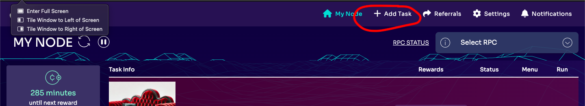

# KeepCryptoClean (Asshole in Chief)

A decentralized Twitter engagement task running on the [Koii Network](https://www.koii.network). Nodes crawl a target Twitter account, post accountability comments, and earn rewards through a validated proof-of-work system backed by IPFS.

## Table of Contents

- [Overview](#overview)
- [How It Works](#how-it-works)
- [Architecture](#architecture)
- [Prerequisites](#prerequisites)
- [Installation](#installation)
- [Configuration](#configuration)
- [Running the Task](#running-the-task)
- [Development](#development)
- [Testing](#testing)
- [Project Structure](#project-structure)
- [Key Concepts](#key-concepts)
- [License](#license)

## Overview

KeepCryptoClean coordinates a network of volunteer-operated nodes that post comments on a target Twitter account's tweets. Each node:

1. Authenticates with Twitter using Puppeteer (headless browser automation)
2. Crawls the target account's tweets
3. Posts one comment per day from a curated comment library
4. Submits proof of work to IPFS
5. Validates other nodes' submissions
6. Receives reward distributions for valid work

The task is rate-limited to **one comment per account every ~24 hours** to avoid account suspension.

## How It Works

Each task round (~3.8 hours) follows four phases:

```
Execute -> Submit -> Audit -> Distribute
```

1. **Execute**: The node logs into Twitter, finds target tweets, and posts a comment. Collected data is stored in a local NeDB database.
2. **Submit**: The node packages collected tweet data as JSON, uploads it to IPFS via KoiiStorageClient, and submits the resulting CID (Content Identifier) to the blockchain.
3. **Audit**: Nodes validate other nodes' submissions by fetching IPFS data and spot-checking a random item against the live Twitter page.
4. **Distribute**: Valid submissions earn rewards; invalid submissions result in stake slashing.

## Architecture

```
index.js                    Entry point & IPC message handler
  |
  +-- coreLogic.js          Task lifecycle orchestration
  |     |
  |     +-- twitter-task.js TwitterTask class (crawler + validator)
  |           |
  |           +-- adapters/twitter/twitter.js  Puppeteer-based Twitter automation
  |           +-- model/data.js                NeDB database abstraction
  |           +-- model/adapter.js             Base adapter class
  |
  +-- @_koii/namespace-wrapper   Koii Network IPC & task state
  +-- @_koii/storage-task-sdk    IPFS storage (KoiiStorageClient)
```

### Core Components

| File | Purpose |
|------|---------|
| `index.js` | Entry point. Sets up IPC listeners and an Express endpoint (`GET /taskState`). |
| `coreLogic.js` | Orchestrates the task lifecycle: execute, submit, audit, and distribute. |
| `twitter-task.js` | Manages the Twitter crawler per round. Handles search term fetching, CID generation, and submission validation. |
| `adapters/twitter/twitter.js` | Puppeteer-based Twitter automation: login, session management, tweet crawling, comment posting, and verification. |
| `model/data.js` | NeDB database wrapper with methods for CRUD operations, search terms, timestamps, and cookies. |
| `model/adapter.js` | Abstract base class for API adapters. Extended by the Twitter adapter. |
| `couch_comments.json` | Fallback comment library used when the middleware server is unavailable. |
| `config-task.yml` | Koii Network task configuration (round timing, stake amounts, resource requirements). |

## Prerequisites

- **Node.js** v16 or higher
- **Yarn** package manager
- A **volunteer Twitter/X account** that has passed Twitter's verification process
- For production deployment: [Koii Network Node](https://www.koii.network)

### System Requirements (for Koii Network deployment)

| Resource | Minimum |
|----------|---------|
| CPU | 4 cores |
| RAM | 5 GB |
| Storage | 5 GB |

## Installation

```bash
git clone https://github.com/chaollapark/KeepCryptoClean.git
cd KeepCryptoClean
yarn install
```

## Configuration

Copy the sample environment file and fill in your Twitter credentials:

```bash
cp .env.sample .env
```

Edit `.env`:

```env
TWITTER_USERNAME="your_twitter_username"
TWITTER_PASSWORD="your_twitter_password"
TWITTER_PHONE="your_phone_number_or_email"
```

| Variable | Description |
|----------|-------------|
| `TWITTER_USERNAME` | Your volunteer Twitter username (without the `@`) |
| `TWITTER_PASSWORD` | Your volunteer Twitter account password |
| `TWITTER_PHONE` | Phone number or email used for Twitter's verification step |

> **Warning**: Use a dedicated volunteer account, not your primary Twitter account.

## Running the Task

### Via Koii Network Node (Production)

1. Download the [Koii Network Node](https://www.koii.network)
2. Sign up and configure your node ([instructions](https://www.koii.network/docs))
3. Click **"Add Task"** and upload the project



4. Configure your Twitter credentials as task variables
5. Run the task

### Via Docker

```bash
docker-compose up
```

This starts:
- A **Redis** container for caching/sessions
- A **Koii task node** container running the task

### Locally (for development)

```bash
yarn start
```

## Development

### Available Scripts

| Command | Description |
|---------|-------------|
| `yarn start` | Start the task node (`node index.js`) |
| `yarn test` | Run the basic single-round test |
| `yarn webpack` | Build with webpack (development mode) |
| `yarn webpack:prod` | Build with webpack (production mode) |
| `yarn deploy` | Build and deploy to Koii Network via CLI |
| `yarn whammy` | Shortcut for `webpack:prod` + `deploy` |
| `yarn prod-debug` | Start with nodemon for production debugging |
| `yarn go` | Full cycle: install, start, test |

### Building for Deployment

```bash
# Development build
yarn webpack

# Production build
yarn webpack:prod

# Build and deploy to Koii Network
yarn deploy
```

### Understanding the Koii Network

To modify and extend this code, familiarize yourself with the Koii Network:

1. **[EZsandbox](https://github.com/koii-network/ezsandbox/blob/main/README.md)** - A guided tutorial covering Koii Network basics
2. **[Koii Network Documentation](https://www.koii.network/docs)** - Full documentation

## Testing

```bash
# Run the default test (single round)
yarn test

# Run individual test files
node tests/test-one-round.js
node tests/twitter.js [search_term]     # Defaults to "Web3" if no term provided
node tests/test-several-rounds.js
node tests/test-validate-cid.js
node tests/testAudits.js
```

### Test Files

| File | Description |
|------|-------------|
| `tests/test-one-round.js` | Single round execution test |
| `tests/test-several-rounds.js` | Multi-round execution test |
| `tests/test-validate-cid.js` | CID validation test |
| `tests/testAudits.js` | Audit logic test |
| `tests/twitter.js` | Twitter adapter integration test |
| `tests/test_data.js` | Database operation tests |
| `tests/twitter-adapter.js` | Adapter unit tests |

## Project Structure

```
KeepCryptoClean/
├── adapters/
│   └── twitter/
│       ├── twitter.js          # Puppeteer-based Twitter automation (1346 lines)
│       └── README.md           # Twitter adapter setup notes
├── helpers/
│   └── db.js                   # Database initialization
├── images/
│   └── AddingTask.png          # Documentation image
├── model/
│   ├── adapter.js              # Base adapter class
│   └── data.js                 # NeDB database abstraction
├── tests/                      # Test suite
├── wasm/
│   └── bincode_js.cjs          # WebAssembly module for Koii integration
├── .env.sample                 # Environment variable template
├── config-task.yml             # Koii task configuration
├── coreLogic.js                # Task lifecycle orchestration
├── couch_comments.json         # Fallback comment library
├── docker-compose.yaml         # Docker setup (Redis + Koii node)
├── index.js                    # Entry point & IPC handler
├── metadata.json               # Koii task metadata
├── twitter-task.js             # TwitterTask class (crawler + validator)
├── webpack.config.js           # Webpack configuration
└── package.json                # Dependencies and scripts
```

## Key Concepts

### Task Rounds

Each round lasts **33,500 slots** (~3.8 hours at ~408ms per slot). A round is divided into three windows:

- **Submission window** (11,500 slots): Nodes execute their task and submit proof
- **Audit window** (11,500 slots): Nodes validate other submissions
- **Distribution**: Rewards are calculated and distributed

### IPFS Submissions

Collected data is packaged as `dataList.json` and uploaded to IPFS. The returned CID serves as proof of work submitted to the Koii blockchain.

### Validation

Auditing nodes fetch another node's IPFS submission, select a random tweet from the data, and verify it against the live Twitter page. Checks include:

- Tweet content hash verification (bcrypt)
- Comment existence and content matching
- Username verification
- Timestamp proximity (within 15 minutes)
- Duplicate ID detection

### Stake and Rewards

- **Minimum stake**: 1.9 KOII
- **Bounty per round**: 10 KOII
- Invalid submissions result in stake penalties
- Valid submissions earn an equal share of the round bounty

### Comment Rate Limiting

The system enforces a ~22-26 hour cooldown between comments per account using a timestamp stored in the local database. This randomized interval helps avoid detection and account suspension.

## Participation Requirements

1. Volunteer a **spare Twitter account** (not your primary account)
2. Ensure the account has passed Twitter's verification process
3. Set up your environment variables with the account credentials

> **Note**: There are no rewards for this task currently, but events and bounties are planned for the future.

## License

[MIT](LICENSE) - Copyright (c) 2024 Madan C. Park and Pranav Mahindru
